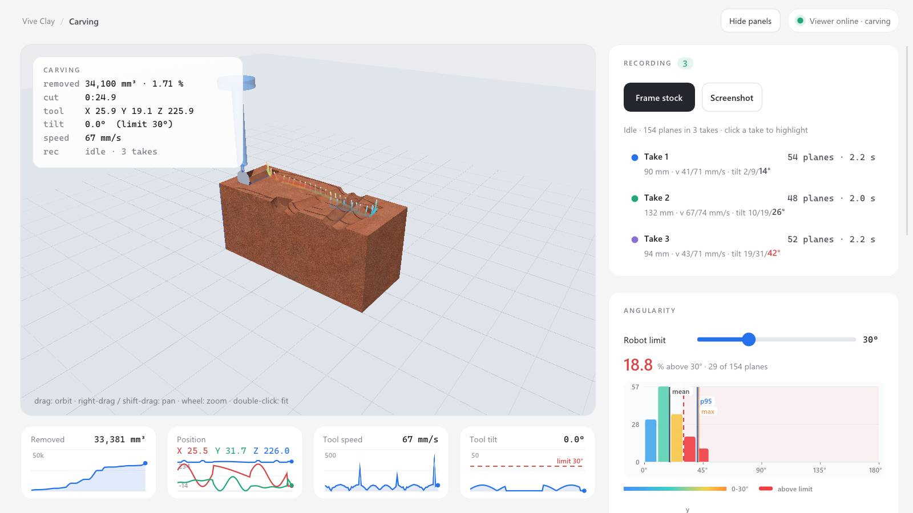
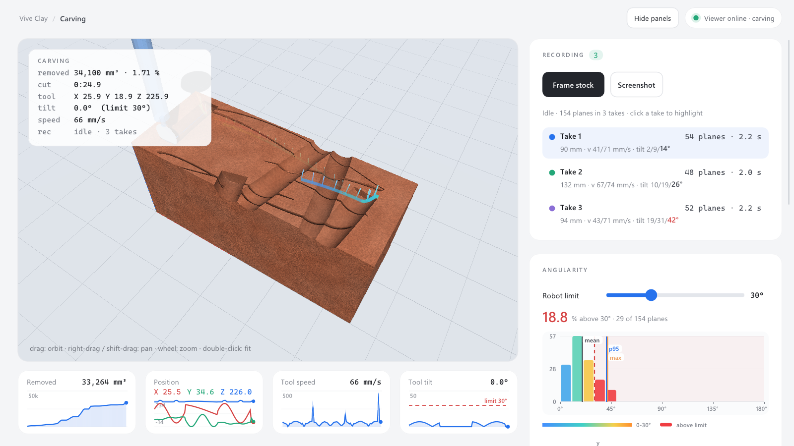

# OpenVR Robotics Toolkit

Stream **HTC Vive Trackers and Lighthouse base stations** (via SteamVR / OpenVR) live into **Rhino 8 + Grasshopper**. Record hand-held tool gestures, watch them carve a virtual clay brick in a live visualiser, analyse them for robot reproduction, and exchange the recorded planes between sites (France ⇄ Austria).

```
 Vive Tracker ──► SteamVR ──► ViveTcpPublisher.exe ──TCP :7000──► Grasshopper (Vive tab)
                                                                    │
                                     Vive Take Recorder ──pipe──► ClayViewer.exe (live carving + analytics)
                                                                    │
                                     Vive Plane Exchange ──HTTPS──► GitHub "plane-data" branch ◄── partner site
```

| File | What it is |
| :--- | :--- |
| `ViveTcpRecorderV2.gha` | The Grasshopper plugin, ready to install |
| `copy_gha_to_grasshopper.bat` | One-click installer (plugin + Clay Viewer) |
| `Grasshopper/ViveTracking_Template.gh` | Template definition with the basic components wired |
| `ViveTcpPublisher/publish-win-x64/ViveTcpPublisher.exe` | SteamVR → TCP streamer |
| `ClayViewer/publish-win-x64/ClayViewer.exe` | External carving visualiser |
| `ViveExchangeSetup/publish-win-x64/ViveExchangeSetup.exe` | Token and invite-link app for the plane exchange |
| `dummy_sender.py` | Simulator that streams fake tracker data (no hardware) |

## Exchanging planes with the partner site (France ⇄ Linz)

Recorded planes travel between the sites through the **Vive Plane Exchange** component (`Vive ▸ Utilities`):

1. **Once per PC:** open the invite link from the France team, type the passphrase in `ViveExchangeSetup.exe`, done. The token is stored encrypted on the PC.
2. **Place the component**, set the **Site** drop-down to your own site (Linz = **Austria**), wire Buttons into `Push` and `Pull`.
3. **Pull** gets the partner's latest set (`Pull Name` = `latest`), with the same data-tree branches it was pushed with. **Push** sends your `Planes` under a `Push Name`.

Step-by-step guide for the partner site: **[docs/PLANE_EXCHANGE.md](docs/PLANE_EXCHANGE.md)** · full workflow: [Step 8](#step-8-exchange-planes-with-the-partner-site).

> `ClayViewer.exe` and `ViveExchangeSetup.exe` are large and not stored in git. If those folders are empty after cloning, run `build_all.bat` once (needs the .NET 8 SDK), or copy them from a PC that has them.

---

# Part A: Step-by-step workshop tutorial

Follow the steps in order the first time. Later sessions start at **Step 3**.

## Step 1. Install (once per PC)

Requirements: Windows 10/11 64-bit, Rhino 8, Steam + SteamVR, a Vive Tracker (2.0/3.0) with its dongle, and 1–4 base stations.

1. Get the repository: **Code ▸ Download ZIP** on GitHub (right-click the ZIP ▸ **Properties** ▸ tick **Unblock** *before* extracting), or:
   ```bash
   git clone https://github.com/pitsieben/OpenVR-Robotics-Toolkit.git
   ```
2. **Close Rhino completely.**
3. Double-click **`copy_gha_to_grasshopper.bat`**. It copies the plugin to `%APPDATA%\Grasshopper\Libraries\` and the Clay Viewer to `%APPDATA%\Grasshopper\Libraries\ClayViewer\`.
4. Start Rhino, type `Grasshopper`. A **Vive** tab appears in the ribbon. (No tab? Right-click the `.gha` in the Libraries folder ▸ Properties ▸ Unblock, restart Rhino.)

Run the installer again every time you get a new version of the plugin.

## Step 2. Prepare SteamVR (once per PC)

1. **Pair the tracker:** start SteamVR, plug in the dongle, *SteamVR menu ▸ Devices ▸ Pair Controller*, hold the tracker's power button until the LED blinks blue.
2. **No headset?** Close SteamVR, right-click **`enable_headless_trackers.ps1`** ▸ **Run with PowerShell**. SteamVR then runs without a headset. (`restore_steamvr_settings.ps1` undoes it. If scripts are blocked, run once: `Set-ExecutionPolicy -Scope CurrentUser RemoteSigned`.)

## Step 3. Launch SteamVR and the stream (every session)

1. Switch on the base stations, start **SteamVR**, switch on the tracker.
2. Wait until the tracker icon in SteamVR is **solid** (not blinking) and its LED is **green**.
3. Run **`ViveTcpPublisher\publish-win-x64\Launch_ViveTcpPublisher.bat`**:
   - `[1]` lists connected devices and serial numbers,
   - `[2]` streams all devices on `127.0.0.1:7000`.
4. **Leave this window open** while you work.

*No hardware?* Double-click `run_dummy_sender.bat` instead (needs Python on PATH). It streams one moving tracker and four base stations on port 7000.

## Step 4. Live tracking in Grasshopper

1. Open `Grasshopper/ViveTracking_Template.gh` (save a copy under a new name), or build it yourself:
2. Place **Vive TCP Listener V2** (`Vive ▸ TCP`), wire a **Boolean Toggle** into `AutoUpdate`, set it to **True**. `Msg` should list your devices.
3. Place **Vive Tracker** (`Vive ▸ Tracking Device`) and wire the listener's `Vive` output into it. `Index` 0 = first tracker.
4. Optional: **Vive Lighthouse** components show the base stations (they number themselves LH1–LH4).
5. **Tool mesh:** model your carving tool in Rhino in **millimetres**, placed so that the world origin `(0,0,0)` is the tracker's tracking centre. Reference it in a Mesh parameter and wire it into the tracker's `Mesh` input. The `Tracker` output now shows the tool moving live.

```
[Toggle True] ─► (AutoUpdate) [Vive TCP Listener V2] (Vive) ─► (Vive) [Vive Tracker] ─► Plane, Tracker (tool mesh), TrackerData
[Tool mesh @ origin] ───────────────────────────────────────► (Mesh)
```

## Step 5. Calibrate the TCP (tool tip)

The **TCP plane** is the plane at the tip of the carving tool. Its **Z axis is the tool's direction reference**: tilt is always measured as the angle between this Z and world Z (0° = Z pointing straight up).

1. Place **Vive Calibration Recorder** (`Vive ▸ TCP`). Wire the tracker's `TrackerData` into `Data`, and Grasshopper **Buttons** into `Record`, `Reset` and `Undo`.
2. Put the tool tip in a fixed dimple and press **Record** at 4 or more clearly different tool angles. (With a pogo-pin switch on the tracker, pressing the switch records too.)
3. Wire `Planes` into **Tool Center Point** (`Vive ▸ Calibration`). Check `Residual`: below ~1 mm is good; otherwise `Undo` / re-record.
4. Build the TCP plane: move (and if needed re-orient) the tracker `Plane` by `TCP_Relative`, so the plane sits on the tip with its Z along the direction you want measured. Check it in the viewport: with the tool held in its "upright" pose the TCP plane's Z should point up.

```
[Vive Tracker] (TrackerData) ─► (Data) [Vive Calibration Recorder] (Planes) ─► (Poses) [Tool Center Point] ─► TCP_Relative, Residual
```

## Step 6. Record takes and carve in the visualiser

1. Place **Vive Take Recorder** (`Vive ▸ TCP`) and wire:
   - `Data` ◄ your **TCP plane** (from Step 5),
   - `Brep` ◄ the **brick / working volume** (a Box, closed Brep or closed Mesh, e.g. the 226.2 × 88 × 100 mm brick placed where the real brick is),
   - `Tool` ◄ the tracker's `Tracker` output (the tool mesh already moved by the tracker),
   - `Record` ◄ a Toggle (True = armed), `Reset` ◄ a Button.
2. Click **Open Visualiser** on the component. `ClayViewer.exe` opens in its own window and shows the brick, the tool and its shadow.
3. Carve: whenever the tool mesh passes through the brick it removes material, **always on**. Every time the TCP enters the brick a new **take** starts recording; leaving it ends the take. (Right-click ▸ **Require Trigger Button to Record** records only while the pogo-pin switch is held.)
   
4. In the visualiser:
   - **Mouse:** drag = orbit, right-drag / shift-drag = pan, wheel = zoom, double-click = fit.
   - **Readout card:** removed volume, cut time, tool position, **tilt** (red above the robot limit), speed, recording state.
   - **Bottom cards:** removed volume, X/Y/Z position graphs, tool speed, tool tilt with the limit line.
   - **Sidebar:** recorded takes (select one to highlight its path), tilt histogram, layers, X-ray.

   
5. Buttons on the component:
   - **Reset Stock** – a fresh brick (recorded takes are kept; use `Reset` to clear takes).
   - **Get Mesh** – sends the carved brick back to Grasshopper on `Carved Mesh`. It is reduced to ~150 000 faces and smoothed, so it's light enough to bake.
   - Right-click ▸ **Carving Resolution** (0.25 / 0.5 / 1 mm): finer = more detail, more memory.
6. Outputs: `Takes` (**one branch per take**, planes in recording order), `Take Count`, `Frame Count`, `Is Inside`, `Status`, `Carved Mesh`, `Results`.

```
[TCP plane] ─────────► (Data)
[Brick Box] ─────────► (Brep)   [Vive Take Recorder]  ─► Takes {take}, Carved Mesh, Results
[Tracker tool mesh] ─► (Tool)        [Open Visualiser] [Reset Stock] [Get Mesh]
```

## Step 7. Analyse and clean the takes

1. **Vive Take Analytics** (`Vive ▸ Utilities`): wire `Results` from the recorder, set `Robot Limit` (default 30°).
   - Per take: frames, duration, path length, mean/max speed, tilt min/mean/max, % above limit.
   - Per plane (same branches as `Takes`): tilt, speed, above-limit flags.
   - Job: removed volume, % of stock, readable `Summary`.
2. **Vive Take Smooth** (`Vive ▸ Utilities`): removes tracking jitter per take. `Position` / `Angle` are Gaussian strengths in frames (start with 3 / 5). Check `Position Change` / `Angle Change` so you don't over-smooth. `Spacing` resamples to equal distance for robot targets.
3. **Vive Plane Straighten** (`Vive ▸ Utilities`): any plane steeper than `Max Tilt` from the `Reference` Z is rotated back to exactly that limit (positions never move). `Fix Roll` removes wrist twist.

Typical chain: `Take Recorder (Takes)` ─► `Take Smooth` ─► `Plane Straighten` ─► robot targets. All of them keep one branch per take.

## Step 8. Exchange planes with the partner site

### 8a. One-time token setup

The repo owner creates a fine-grained GitHub token (Contents: read & write on this repo only) — full instructions and the `main` protection rules are in [docs/PLANE_EXCHANGE.md](docs/PLANE_EXCHANGE.md). Then on each PC:

1. Run **`ViveExchangeSetup\publish-win-x64\ViveExchangeSetup.exe`**.
2. **My token** tab: paste the token ▸ *Check & save*. It is stored encrypted (Windows DPAPI) next to the installed plugin; nothing readable is written to disk or to your .gh file.
3. To give the partner access: **Create invite** tab ▸ copy the `viveexchange://invite/...` link and its passphrase. **Send link and passphrase through two different channels** (e.g. link by email, passphrase by Signal/phone).
4. The partner opens the link (or pastes it in **Accept invite**), types the passphrase, and is set up.

*(Alternative: `set_exchange_token.ps1` stores a token the same way.)*

### 8b. Push and pull from Grasshopper

1. Place **Vive Plane Exchange**. A **Site** drop-down (France / Austria) appears automatically. Pick **your** site:
   - **France** pushes to the `france` folder and pulls from `austria`,
   - **Austria** pushes to `austria` and pulls from `france`.
2. Wire your planes into `Planes` — e.g. the recorder's `Takes` or the smoothed/straightened tree. **The data-tree structure is kept**: 12 branches pushed come back as the same 12 branches.
3. Optionally type a `Push Name` (empty = timestamp). Press the **Push** button. Every push is also saved as `latest`.
4. On the other site, set `Pull Name` (default `latest`) and press **Pull**. `Pulled Planes` returns the tree, scaled to that document's units; `Info` shows site, name, time and units.
5. Hidden extras: zoom in on the component and click **+** to add `Repo`, `Pull Repo`, `Branch` (default `plane-data`), `Token`, `List` (button: fills `Available` with the other site's set names) and `Note`. **Leave `Token` empty** — anything typed there is saved in the .gh file.

```
[Takes / smoothed tree] ─► (Planes)
[Site: France]          ─► (Site)    [Vive Plane Exchange] ─► Pulled Planes (same tree), Info, Available, Status
[Button] ─► (Push)   [Button] ─► (Pull)   "run-03" ─► (Push Name)   "latest" ─► (Pull Name)
```

## Step 9. End of session

1. **Get Mesh** and bake the carved brick if you want to keep it; internalise or bake the `Takes`.
2. Push the final takes (Step 8b) with a clear `Push Name`.
3. Close the visualiser, the publisher window and SteamVR.

---

# Part B: Reference

## Component overview

| Component | Ribbon | Role | Key inputs | Key outputs |
| :--- | :--- | :--- | :--- | :--- |
| **Vive TCP Listener V2** | `Vive ▸ TCP` | Receives the stream (50 FPS throttled) | `AutoUpdate`, `IP` (`127.0.0.1:7000`) | `Msg`, `Vive`, `Plane`, `Time` |
| **Vive Tracker** | `Vive ▸ Tracking Device` | Tracker pose, tool mesh, buttons | `Vive`, `Index`, `Mesh` | `Tracker`, `Plane`, `Matrix`, `TrackerData`, `Trigger` |
| **Vive Lighthouse** | `Vive ▸ Tracking Device` | Base station pose and beam plane | `Vive`, `Index` | `Lighthouse`, `Plane`, `Matrix` |
| **Vive Calibration Recorder** | `Vive ▸ TCP` | Captures single poses for calibration | `Data`, `Record`, `Reset`, `Undo` | `Planes`, `Points`, `Tree`, `Count`, `Status` |
| **Tool Center Point** | `Vive ▸ Calibration` | Least-squares tip / pivot fit (4+ poses) | `Poses` | `TCP_Relative`, `TCP`, `FixedPoint`, `Residual`, `Errors`, `Status` |
| **Vive Take Recorder** | `Vive ▸ TCP` | Records takes + drives the Clay Viewer | `Data`, `Brep`, `Record`, `Delay`, `Tolerance`, `Reset`, `Tool` | `Takes`, `Take Count`, `Frame Count`, `Is Inside`, `Status`, `Carved Mesh`, `Results` |
| **Vive Take Analytics** | `Vive ▸ Utilities` | Statistics per take / plane / job | `Results`, `Robot Limit` | speeds, tilts, flags, `Removed Volume`, `% of Stock`, `Summary` |
| **Vive Take Smooth** | `Vive ▸ Utilities` | Jitter removal per take | `Planes`, `Position`, `Angle`, `Keep Ends`, `Spacing`, `Degree` | `Planes`, `Curve`, `Position Change`, `Angle Change`, `Status` |
| **Vive Plane Straighten** | `Vive ▸ Utilities` | Clamp tilt to a robot limit | `Planes`, `Max Tilt`, `Reference`, `Flip Axis`, `Fix Roll` | `Planes`, `Tilt`, `Clamped`, `Status` |
| **Vive Plane Exchange** | `Vive ▸ Utilities` | Push / pull plane trees via GitHub | `Planes`, `Site`, `Push`, `Pull`, `Push Name`, `Pull Name` (+ hidden extras) | `Pulled Planes`, `Info`, `Available`, `Status` |

## Vive Take Recorder details

- `Data` (tree): the plane to record, normally the TCP plane. A `TrackerData` payload supplies its plane only when no plane is given. Tilt, the viewer's recorded planes and all analytics use this plane.
- `Brep`: working volume **and** carving stock. A box is carved as a box, anything else as a mesh.
- `Delay` (ms) / `Tolerance` (mm): minimum time / movement between recorded frames.
- `Tool`: the tracker-posed tool mesh. The first mesh received is the reference; later ones must be rigid copies of it (otherwise a warning appears and carving pauses).
- `Takes`: `{take}`, or `{device;take}` with several devices.
- The viewer is found in a `ClayViewer` folder next to the `.gha`, or in `ClayViewer/publish-win-x64` in the repo.
- Right-click: **Require Trigger Button to Record**, **Clear All Takes**, **Carving Resolution**.

**Tilt** everywhere (viewer readout, histogram, Take Analytics) = angle between the TCP plane's Z axis and world Z, 0° (pointing up) to 180°.

## Plane Exchange details

- Files are written to `planes/<site>/<name>.json` and `planes/<site>/latest.json` on the `plane-data` branch. Each plane stores its Grasshopper branch path, so the tree comes back unchanged. Sets pushed by older versions (no paths) come back in branch `{0}`.
- Token lookup order: `Token` input → env `VIVE_EXCHANGE_TOKEN` → `ViveExchange` folder next to the `.gha` → `%APPDATA%\Grasshopper\Libraries\ViveExchange` → `%APPDATA%\ViveExchange`.
- Pulling from a public repo works without a token.
- Nothing can be merged to `main` without the owner's approval (ruleset + `CODEOWNERS`); see [docs/PLANE_EXCHANGE.md](docs/PLANE_EXCHANGE.md).
- Files saved with the old 13-input version keep all their inputs and still work.

## Physical trigger (pogo pins)

Six pads under the tracker; shorting a pin to **Pin 2 (GND)** registers a button:

| Pin | Function | Wiring |
| :--- | :--- | :--- |
| 1 | GPO / haptics | ~3.3 V output |
| **2** | **Ground** | switch COM |
| 3 | Grip | short to pin 2 |
| **4** | **Trigger** | switch NO |
| 5 | Trackpad click | short to pin 2 |
| 6 | Menu | short to pin 2 |

`Vive Tracker ▸ Trigger` is True while pressed; the Calibration Recorder records on a press (wire `TrackerData`); the Take Recorder can require it (right-click).

## Troubleshooting

| Problem | Fix |
| :--- | :--- |
| No **Vive** tab | Unblock the `.gha` (Properties ▸ Unblock) and restart Rhino. |
| Listener *not connected* | Publisher / simulator not running, or wrong `IP` (should be `127.0.0.1:7000`). |
| Publisher lists no trackers | SteamVR not running, tracker not paired, or base stations can't see it (icon blinking). |
| SteamVR asks for a headset | Close SteamVR, run `enable_headless_trackers.ps1`. |
| Port 7000 in use | Only one publisher/simulator per port; close the other or use `--port`. |
| "Viewer not found" | Run `copy_gha_to_grasshopper.bat`, or `build_all.bat` if `ClayViewer/publish-win-x64` is empty. |
| Nothing carves | Tool mesh not wired, or not a rigid copy of the first mesh (see the recorder warning). Press **Reset Stock** after changing the brick. |
| Tilt looks wrong | Tilt follows the plane in `Data`: make sure it is the TCP plane with Z along your reference direction. |
| Push: `401` / needs token | Token missing or expired: redo Step 8a. |
| The copy script fails | Rhino is still running; close it completely. |

## Building from source (developers)

Needs the **.NET 8 SDK** and **Rhino 8** in the default location. Run `build_all.bat`: it builds the plugin, then publishes `ViveTcpPublisher.exe`, `ClayViewer.exe` and `ViveExchangeSetup.exe` into their `publish-win-x64` folders. Copy the new `.gha` to the repo root to update the shipped one. For a different Rhino location pass `-p:RhinoSystemDir=... -p:GrasshopperDir=...`. `ClayViewer.exe --selftest` runs the carving checks. The TCP packet format is in [ViveTcpPublisher/README.md](ViveTcpPublisher/README.md).

**Release ZIP:** `powershell -ExecutionPolicy Bypass -File package_release.ps1 [-Version 1.2.0] [-SkipBuild]` builds everything, runs the viewer self-test and writes `dist\OpenVR-Robotics-Toolkit-<version>.zip`. The ZIP holds only the compiled programs, the plugin, the template, the scripts and the docs (no source code), with a `VERSION.txt` naming the git commit. It refuses to pack any token file. The version defaults to today's date.

## Repository structure

```
├── ViveTcpRecorderV2.gha            # Grasshopper plugin, ready to install
├── copy_gha_to_grasshopper.bat      # Installer (plugin + Clay Viewer)
├── Grasshopper/ViveTracking_Template.gh
├── ViveTcpPublisher/                # SteamVR → TCP streamer
├── ViveGrasshopperRecorder/         # Plugin source (C#)
├── ClayViewer/                      # Carving visualiser (Silk.NET OpenGL + ImGui)
├── ViveExchangeSetup/               # Token / invite app
├── docs/PLANE_EXCHANGE.md           # Exchange setup, tokens, main protection
├── set_exchange_token.ps1           # Token by script (alternative to the app)
├── enable_headless_trackers.ps1 / restore_steamvr_settings.ps1
├── dummy_sender.py, run_dummy_sender.bat, run_two_dummy_senders.bat
└── build_all.bat
```

## License & credits

- Uses the Valve OpenVR SDK (`openvr_api.dll`), see [THIRD_PARTY_NOTICES](ViveTcpPublisher/THIRD_PARTY_NOTICES.md).
- Rhino and Grasshopper are registered trademarks of Robert McNeel & Associates.
